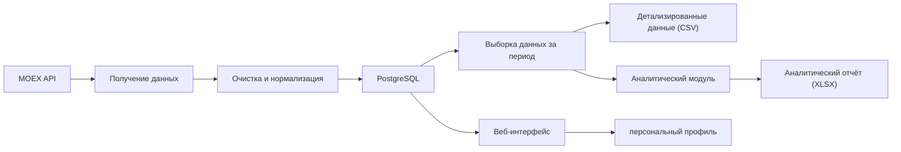

# 📈 Stock Data Service

**Stock Data Service** — это автономный сервис для сбора, обработки и анализа биржевых данных с MOEX API.

Проект представляет собой модульную ETL-систему (Extract – Transform – Load) для автоматического сбора, обработки и хранения биржевых котировок и торговых показателей.

Система автоматически извлекает данные с Московской биржи (MOEX), очищает и нормализует их, а затем сохраняет в базу данных PostgreSQL. Пользователи могут получать доступ к данным через веб-интерфейс и формировать аналитические отчеты.

## 🎯 Основные возможности

* 🔍 **Автоматический сбор данных с MOEX API** - асинхронное получение биржевых котировок (цены, объемы, изменения) для акций рынка TQBR

* 🧹 **Очистка и нормализация данных** - автоматическая обработка сырых данных: преобразование типов, удаление некорректных записей, перерасчет процентных изменений

* 📊 **Аналитическая обработка** - расчет статистических показателей по каждому финансовому инструменту за выбранный период

* 📥 **Экспорт данных в CSV и XLSX** - выгрузка как детализированных котировок, так и аналитических сводок

* 🔐 **Личный кабинет пользователя** - авторизация, персональный профиль 

* ⏰ **Планировщик задач** - автоматический сбор данных в рабочие часы биржи (10:00-19:00) с интервалом 10 минут

## 🔄 Архитектура процесса



## 📊 Аналитический модуль

Модуль выполняет статистическую обработку исторических биржевых данных и формирует агрегированные показатели по каждому финансовому инструменту за выбранный период.

После загрузки и нормализации котировок данные передаются в аналитический слой, где выполняется группировка по тикерам и их наименованиям с расчетом основных статистических характеристик.

Модуль рассчитывает:

- **Количество наблюдений** по тикеру
- **Среднюю цену** актива
- **Медианную цену** 
- **Минимальное и максимальное** значение цены
- **Среднее изменение** цены
- **Среднее процентное** изменение
- **Суммарный торговый объем**
- **Суммарную стоимость торгов**

Полученные результаты используются для формирования аналитических XLSX-отчетов и позволяют проводить первичный анализ динамики и торговой активности выбранных инструментов.

## 💡 Бизнес-ценность

Система предоставляет структурированные биржевые данные для финансового анализа, исследовательских задач и построения предиктивных моделей. Автоматизированный процесс сбора и обработки данных экономит время и ресурсы, позволяя сосредоточиться на анализе и принятии решений.

## 🔥 Ключевые преимущества для бизнеса

* 📊 **Структурированные данные** для финансовой аналитики, исследовательских задач и построения собственных моделей

* ⛓ **Автоматизированный процесс сбора и обработки данных**

---

## Панель администратора
<br />
*Простейшая админка на SQL Admin для внутреннего тестирования. Позже планируется переход на полноценную админку с авторизацией.*

## Форма регистрации пользователя
<br />

### Форма авторизации пользователя
<br />

## 🧑‍💼 Веб-интерфейс личного кабинета пользователя

Личный кабинет включает защищённый веб-интерфейс предоставляет доступ к биржевым данным, позволяет просматривать актуальные котировки и выполнять экспорт данных для дальнейшего анализа.
<br />
<br />
<br />

### Структура данных

| Поле           | Описание                                                     |
| -------------- | ------------------------------------------------------------ |
| id             | Уникальный идентификатор записи котировки                    |
| update_time    | Время последнего обновления котировки                        |
| ticker         | Тикер ценной бумаги                                          |
| name           | Полное название ценной бумаги                                |
| last_price     | Последняя цена на момент обновления                          |
| prev_price     | Цена закрытия предыдущей торговой сессии                     |
| change         | Изменение цены относительно предыдущего закрытия             |
| change_percent | Процентное изменение цены относительно предыдущего закрытия  |
| open           | Цена открытия текущей торговой сессии                        |
| high           | Максимальная цена за текущую торговую сессию                 |
| low            | Минимальная цена за текущую торговую сессию                  |
| volume         | Объём торгов в штуках (количество купленных/проданных лотов) |
| value          | Общая стоимость совершённых сделок                           |
| lot_size       | Размер лота                                                  |

---

## 🛠️ Технологии

| Модуль        | Описание                                                                                           |
| ------------- | -------------------------------------------------------------------------------------------------- |
| `aiohttp`     | Асинхронное получение данных через HTTP API                                                        |
| `FastAPI`     | Создание веб-интерфейса                                                                            |
| `authx`       | Управление аутентификацией и авторизацией пользователей, генерация и проверка токенов безопасности |
| `bcrypt`      | Хеширование пароля                                                                                 |
| `sqladmin`    | Веб-интерфейс для администрирования базы данных                                                    |
| `SQLAlchemy`  | Работа с PostgreSQL через ORM и выполнение SQL-запросов                                            |
| `Alembic`     | Управление миграциями базы данных                                                                  |
| `openpyxl`    | Создание Excel-отчётов                                                                             |
| `pandas`      | Обработка и очистка данных                                                                         |
| `APScheduler` | Асинхронный планировщик задач                                                                      |
| `zipfile`     | Архивирование файлов                                                                               |
| `aiosmtplib`  | Асинхронная работа с SMTP-протоколом                                                               |
| `pytest`      | Тестирование и автоматизация тестов                                                                |

---

## 📁 Структура проекта

```
Stock-Data-Service/
├── migrations/            # Миграции базы данных
├── src/                    # Основной код приложения
│   ├── __init__.py
│   ├── main.py            # Точка входа в приложение
│   ├── scheduler.py       # Планировщик задач
│   ├── admin_panel/       # Панель администратора
│   │   ├── __init__.py
│   │   └── views.py
│   ├── auth/              # Аутентификация и авторизация
│   │   ├── __init__.py
│   │   ├── service.py
│   │   └── router.py
│   ├── user/              # Учетные записи пользователей
│   │   ├── __init__.py
│   │   ├── crud.py
│   │   ├── models.py
│   │   ├── schemas.py
│   │   ├── service.py
│   │   └── router.py
│   ├── core/              # Основной роутер и бизнес-логика
│   │   ├── __init__.py
│   │   └── router.py
│   ├── db/                # Работа с базой данных
│   │   ├── __init__.py
│   │   ├── database.py
│   │   └── base.py
│   ├── email/             # Логика отправки email
│   │   ├── __init__.py
│   │   ├── crud.py
│   │   ├── models.py
│   │   ├── router.py
│   │   └── service.py
│   ├── quotes/            # Работа с биржевыми данными
│   │   ├── __init__.py
│   │   ├── crud.py
│   │   ├── models.py
│   │   └── router.py
│   ├── profile/           # Личный кабинет пользователя
│   │   ├── __init__.py
│   │   └── router.py
│   ├── parsing/           # Парсинг и обработка данных
│   │   ├── __init__.py
│   │   ├── data_parser.py
│   │   └── data_processor.py
│   ├── report/            # Формирование отчётов
│   │   ├── __init__.py
│   │   ├── analytics.py
│   │   ├── csv_generator.py
│   │   ├── xlsx_generator.py
│   │   └── router.py
│   ├── static/            # Статические файлы
│   └── templates/         # Веб-шаблоны
├── tests/                # Тесты
│   ├── __init__.py
│   ├── test_data_processor.py
│   └── test_schemas.py
├── logs/                 # Лог-файлы
├── Dockerfile            # Контейнеризация
├── docker-compose.yml    # Сборка и запуск контейнеров
├── .env                  # Переменные окружения
├── run_parser.py         # Скрипт запуска парсера
├── pyproject.toml        # Конфигурация проекта
├── alembic.ini          # Конфигурация миграций
└── uv.lock              # Зависимости проекта
```
---

## ⚠️ Известные ограничения

* ⏰ **Режим работы планировщика**: 10:00–19:00 по будням
* 🔁 **Интервал сбора данных**: 10 минут
* 🔐 **Админ-панель**: тестовый интерфейс SQLAdmin для внутреннего использования

---

## 🚀 Быстрый старт

1. Клонирование репозитория:

```bash
git clone https://github.com/fetgrigory/Stock-Data-Service.git
```

2. Подключение к базе данных на PostgreSQL

Для работы с базой данных требуется указать параметры подключения в файле `.env`:

* **HOST**: Адрес хоста базы данных.
* **DBNAME**: Имя базы данных.
* **USER**: Имя пользователя для доступа к базе данных.
* **PASSWORD**: Пароль к базе данных.
* **PORT**: Порт для подключения (например, 5432 по умолчанию для PostgreSQL).

### Пример заполнения:

```plaintext
HOST="localhost"
DBNAME="example_db"
USER="admin_user"
PASSWORD="strongpassword"
PORT="5432"
```

3. Создайте виртуальное окружение для изоляции зависимостей проекта.

Используйте команду:

```bash
uv venv
```

4. Активируйте виртуальное окружение:

* На Windows:

```bash
.venv\Scripts\activate
```

* На macOS и Linux:

```bash
source .venv/bin/activate
```

5. Установка зависимостей:

```bash
uv sync
```

6. Сборка образа в Docker:

```bash
docker-compose up -d --build
```

7. Запуск контейнера:

```bash
docker-compose up
```

8. Создание миграций (только при изменении моделей):

```bash
docker-compose exec stock-service uv run alembic revision --autogenerate -m "init schema"
```

9. Применить миграции:

```bash
docker-compose exec stock-service uv run alembic upgrade head
```

* Swagger UI доступен по адресу http://127.0.0.1:8000/docs
* Ввод пользователей через форму для удобного тестирования
